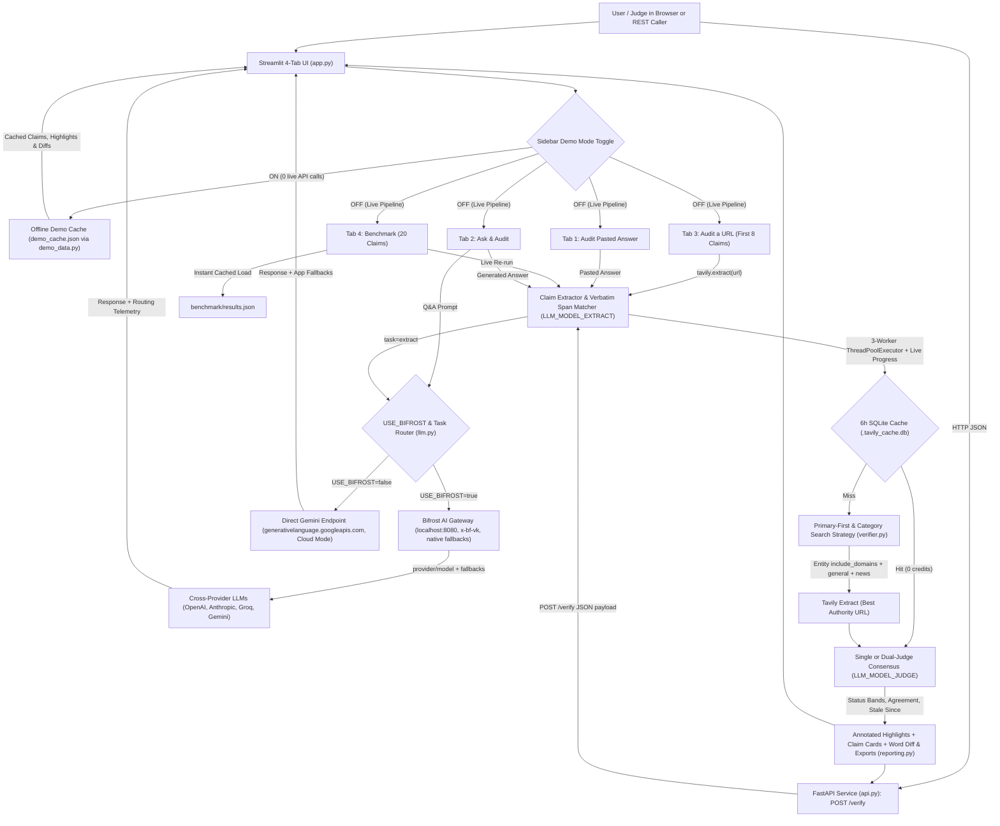

# Stale-Answer Detector

Verify time-sensitive AI claims against live web sources, inspect explainable freshness scores (`0–100`), highlight stale facts inline, and rewrite outdated answers with today's verified evidence.

---

## The Problem

LLM responses are frozen at their training cutoff (or searchless generation step) and silently go stale when the real world moves on:

- **Product & API pricing** shifts (flagship smartphone prices, token pricing tiers, SaaS subscriptions)
- **Software, OS & SDK versions** ship new major releases or deprecate old ones
- **Laws, tax slabs, & compliance rules** get amended or retired
- **Company leadership, acquisitions, & valuations** change unexpectedly
- **Macro statistics, interest rates, & benchmarks** move every quarter

Users rarely know *which* sentence in a polished AI response is still accurate and which detail is quietly outdated. **Stale-Answer Detector** audits AI text claim-by-claim against live web evidence so outdated facts are flagged, explained, sourced, and cleanly rewritten.

---

## Features

- **Four Interactive Workspaces in [`app.py`](app.py)**:
  - **Audit pasted answer**: Paste any AI response (or click one of 4 sidebar sample prompts) to inspect inline claim highlights, hover corrected values, click-to-card scroll anchors, score ring, KPI cards, and per-claim breakdowns.
  - **Ask & Audit**: Type a question, fetch a live answer through Bifrost (or Direct Gemini), view it immediately, and watch the detector auto-audit and underline outdated (`red`), fresh (`green`), uncertain (`yellow`), and unverifiable (`grey`) spans in place.
  - **Audit a URL**: Paste any article or blog URL, pull clean text with **Tavily Extract**, and verify the first **8** time-sensitive claims concurrently.
  - **Benchmark**: Evaluates `benchmark/dataset.json` (20 balanced claims) for accuracy, stale precision/recall/F1, confusion matrix, category breakdown, latency, tokens, and Tavily credits—loading cached `benchmark/results.json` instantaneously when present.
- **Offline Demo Mode**: A one-click **Demo mode** toggle in the sidebar replays pre-verified audits, annotated highlights, side-by-side diffs, and rewrites across all tabs from `demo_cache.json` (`0` live API calls, `0` Tavily credits), plus one-click recovery buttons if an API key is missing or an upstream endpoint is unreachable.
- **Explainable Status-Banded Scoring (`0–100` / `N/A`)**: Enforces clear status bands (**Fresh** `75–100`, **Uncertain** `40–74`, **Outdated** `0–39`, **Unverifiable** `N/A`), risk-weighted overall scoring (regulation & price weighted higher than version), and calibrated **High / Medium / Low** confidence.
- **Primary-Source Evidence Layer**: Prioritizes official domains (`apple.com`, `openai.com`, `python.org`, `gstcouncil.gov.in`, `rbi.org.in`, etc.), labels source chips (**Primary**, **News**, **Blog**, **Forum**), keeps <=25-word evidence snippets, flags source conflicts, and estimates **Stale since** (`stale for ~X months`).
- **Side-by-Side Word Diff & Report Exports**: Always displays a word-level red/green comparison alongside *"What changed & why"* cards, plain-text copy, and **Download report (Markdown)** / **Download JSON** exports.
- **Parallel Execution, Caching & Friendly Errors**: Runs 3 concurrent verification workers with a live `st.progress` bar, loading skeletons, a thread-safe 6-hour SQLite Tavily cache, and user-friendly error messages with zero raw stack traces.
- **Programmatic FastAPI Service ([`api.py`](api.py))**: Exposes `POST /verify` and `GET /health` so external AI agents and backends can audit answers over HTTP.

---

## Architecture



---

## How Tavily Is Used

[`verifier.py`](verifier.py) uses `tavily-python` with primary-first entity routing, category-aware search strategies, targeted extraction, and strict credit conservation:

| Claim Category | Risk Level | Tavily Search Strategy | Search Depth |
| :--- | :--- | :--- | :--- |
| Known entity (OpenAI, Apple, Python, GST, RBI, etc.) | Critical / Moderate | **Primary-first**: Search #1 restricted via `include_domains` to official entity domains + Search #2 open `topic="general"` | `advanced` (critical) / `basic` |
| `price` (unmapped entity) | Critical | Dual search: `topic="news"` (`time_range="month"`) + `topic="general"` | `advanced` |
| `regulation` (unmapped entity) | Critical | Official/gov `include_domains` (`*.gov`, `*.gov.in`, `sec.gov`, `europa.eu`, etc.) with `include_domains_mode="prefer"` | `advanced` |
| `version`, `company` (unmapped entity) | Moderate | Dual search: `topic="news"` (`time_range="month"`) + `topic="general"` | `basic` |
| `statistic`, `other` | Moderate / Low | Single `topic="general"` search | `basic` |

1. **Configurable Primary Domain Map (`ENTITY_DOMAIN_MAP`)**: Built-in entity-to-domain mappings can be extended or overridden at runtime or via the `ENTITY_DOMAIN_MAP` JSON environment variable.
2. **Source Type Labels, Dates & <=25-Word Evidence Snippets**: Every source chip is tagged **Primary**, **News**, **Blog**, or **Forum** alongside its `published_date` and a concise snippet inside each claim's **Evidence snippets** expander.
3. **Single-URL & Full-Article `tavily.extract()`**: Inside claim verification, selects the highest-authority/primary URL to extract exact figures, effective dates, and thresholds. In **Audit a URL**, extracts clean text from any pasted webpage (6-hour cached, 12,000-character cap) and audits the first **8** claims.
4. **Parallel Verification & Thread-Safe 6h Cache**: Verifies claims concurrently using `ThreadPoolExecutor(max_workers=3)` with a live `st.progress` bar, mutex-guarded 6-hour SQLite cache (`.tavily_cache.db`), and exact session credit accounting (`Tavily credits used this session`). Cache entries can be cleared from the sidebar **Settings** expander.
5. **Agreement Tracking, Conflict Detection & Stale-Since Estimation**: Computes `"N of M sources agree"`, marks conflicting sources explicitly as **Uncertain** (*Sources disagree*), and estimates **Stale since** (`stale for ~X months`) from the earliest dated source describing the change.
6. **Status-Banded Explainable Scoring**:
   - **Fresh**: `75–100`
   - **Uncertain**: `40–74`
   - **Outdated**: `0–39`
   - **Unverifiable**: `N/A`
   - Combines **50%** LLM Verdict, **20%** Source Recency, **20%** Source Agreement, and **10%** Source Authority into an explainable `score_breakdown`, clamped cleanly inside the claim's status band.

---

## How Bifrost Is Used

[`llm.py`](llm.py) acts as a gateway-aware OpenAI SDK client supporting **Bifrost AI Gateway mode** (`USE_BIFROST=true`, default) as well as **Direct Gemini mode** (`USE_BIFROST=false`) for cloud deployments:

### 1. Bifrost AI Gateway Features (`USE_BIFROST=true`)
- **Task-Based Model Routing**:
  - `LLM_MODEL_EXTRACT` routes claim extraction to a fast, low-cost model (e.g., `gemini/gemini-2.5-flash-lite` or `openai/gpt-4o-mini`).
  - `LLM_MODEL_JUDGE` routes claim freshness judging to a stronger model (e.g., `openai/gpt-4o-mini` or `anthropic/claude-3-5-sonnet-20241022`). Both default to `LLM_MODEL` when unset, and active per-task models appear in the sidebar **Gateway panel**.
- **Dual-Judge Consensus Mode (`Dual-judge mode` sidebar toggle)**:
  - Runs two distinct judge models through Bifrost over the same Tavily evidence (only one Tavily pass per claim).
  - Agreement displays a **`2/2 models agree`** badge and averages scores cleanly; disagreement automatically marks the claim **Uncertain** (`40–74` band, `low` confidence) with a **`Models disagree`** badge and side-by-side judge verdicts.
- **Cross-Provider Fallbacks (`provider/model` format)**:
  - Accepts mixed-provider fallback lists in `LLM_MODEL_FALLBACKS` using Bifrost's canonical `provider/model` syntax (such as `openai/gpt-4o-mini,anthropic/claude-3-5-sonnet-20241022,groq/llama-3.3-70b-versatile,gemini/gemini-2.5-flash`), passed directly via `extra_body={"fallbacks": [...]}`.
- **Virtual Key Support (`LLM_VIRTUAL_KEY`)**:
  - Reads optional `LLM_VIRTUAL_KEY` and sends `default_headers={"x-bf-vk": ...}` on every gateway call.
- **Live Sidebar Gateway Panel & Outage Failover Demo**:
  - Probes `GET /health` for a green **Gateway healthy** or red **Gateway offline** badge and links directly to **Bifrost dashboard logs** (`http://localhost:8080`).
  - Displays **Total audit time**, **Avg latency / call**, **Fallback count**, **Task routing**, session token totals, a collapsible **Request log** drawer, and `Fallback used: A -> B` badges.
  - Includes a **Simulate provider outage** toggle to force a primary model failure so Bifrost demonstrates automatic failover live.

### 2. Adding a Second Provider Key in the Bifrost Dashboard

To enable **cross-provider fallbacks** or **Dual-judge mode** across two providers **without hardcoding any keys in your codebase**:

1. Open your local Bifrost dashboard at `http://localhost:8080`.
2. Navigate to **Model Providers** (or **Providers**) in the left sidebar.
3. Choose the second provider you want to enable (**OpenAI**, **Anthropic**, **Groq**, or **Gemini**) and click **Add Key**.
4. Enter your provider credential inside the dashboard dialog (or reference a host environment variable with Bifrost's `env.VAR_NAME` syntax, e.g. `env.ANTHROPIC_API_KEY`) and click **Save**. Never commit API keys to `.env.example` or source files.
5. **If using `LLM_VIRTUAL_KEY` (`x-bf-vk`)**: open **Virtual Keys**, edit your virtual key, and ensure the second provider is permitted under **Allowed Providers** (or enable **Allow all providers**) so Bifrost does not reject fallback providers with `401`/`403`.
6. Configure `LLM_MODEL_FALLBACKS` and optional `LLM_MODEL_JUDGE_2` in `.env` using `provider/model` syntax.

### 3. Direct Gemini Cloud Mode (`USE_BIFROST=false`)
- Built for **Streamlit Community Cloud** or environments without a local Bifrost gateway.
- Automatically switches `base_url` to Google Gemini's OpenAI-compatible endpoint (`https://generativelanguage.googleapis.com/v1beta/openai/`), reads keys from environment variables or `st.secrets`, omits Bifrost headers (`x-bf-vk`) and `extra_body.fallbacks`, normalizes `gemini/` prefixes, and executes app-level fallback across Gemini models on `429`, `500`, `503`, or `404`.

---

## Setup Steps

### 1. Clone and Install Dependencies

```bash
git clone <your-repo-url>
cd stale-detector
pip install -r requirements.txt
```

### 2. Zero-Setup Offline Demo Mode (No API Keys Required)

To launch the UI immediately for evaluation—even offline or without API keys—start Streamlit and toggle **Demo mode** ON in the sidebar:

```bash
streamlit run app.py
```

### 3. Option A — Run Locally with Bifrost (`USE_BIFROST=true`)

1. Start your Bifrost gateway (default `http://localhost:8080`) and add provider keys inside the Bifrost dashboard.
2. Copy `.env.example` to `.env`:

   ```bash
   cp .env.example .env
   ```

3. Edit `.env`:

   ```env
   USE_BIFROST=true
   LLM_BASE_URL=http://localhost:8080/v1
   LLM_API_KEY=bifrost-local
   LLM_MODEL=gemini/gemini-2.5-flash

   # Task-based routing (optional; default to LLM_MODEL)
   LLM_MODEL_EXTRACT=gemini/gemini-2.5-flash-lite
   LLM_MODEL_JUDGE=openai/gpt-4o-mini

   # Cross-provider fallbacks in Bifrost provider/model format
   LLM_MODEL_FALLBACKS=openai/gpt-4o-mini,anthropic/claude-3-5-sonnet-20241022,groq/llama-3.3-70b-versatile

   # Optional Bifrost virtual key (sent as x-bf-vk):
   # LLM_VIRTUAL_KEY=bf_vk_your_virtual_key

   TAVILY_API_KEY=tvly-your-tavily-api-key
   ```

4. Launch the Streamlit app:

   ```bash
   streamlit run app.py
   ```

### 4. Option B — Deploy on Streamlit Community Cloud (`USE_BIFROST=false`)

No local Bifrost gateway is needed for **Streamlit Community Cloud**. Set `USE_BIFROST = "false"` alongside your Google Gemini and Tavily keys:

1. Push your repository to GitHub (make sure `.env` and `.streamlit/secrets.toml` remain ignored by `.gitignore`).
2. In Streamlit Community Cloud, click **Create app**, point to your repository, branch, and main file [`app.py`](app.py).
3. Under **Advanced settings → Secrets** (or locally in `.streamlit/secrets.toml` copied from [`.streamlit/secrets.toml.example`](.streamlit/secrets.toml.example)), add:

```toml
USE_BIFROST = "false"
LLM_API_KEY = "your-google-gemini-api-key"
LLM_MODEL = "gemini-2.5-flash"
LLM_MODEL_EXTRACT = "gemini-2.5-flash-lite"
LLM_MODEL_JUDGE = "gemini-2.5-flash"
LLM_MODEL_FALLBACKS = "gemini-2.5-flash-lite,gemini-2.0-flash"
TAVILY_API_KEY = "tvly-your-tavily-api-key"
```

*(You can also run Direct Gemini locally in `.env` with `USE_BIFROST=false` and `LLM_API_KEY` or `GEMINI_API_KEY`.)*

### 5. Run the REST API (`api.py`)

External AI pipelines can call the detector over HTTP via FastAPI:

```bash
uvicorn api:app --host 0.0.0.0 --port 8000
```

Interactive OpenAPI documentation is served at `http://localhost:8000/docs`.

```bash
curl -X POST http://localhost:8000/verify \
  -H "Content-Type: application/json" \
  -d '{
    "answer": "Apple sells the iPhone 15 Pro Max as its latest flagship for $1,199, and OpenAI GPT-4 Turbo costs $10 per million input tokens.",
    "dual_judge": false
  }'
```

### 6. Run Automated Tests

```bash
python -m unittest test_llm.py test_extractor.py test_verifier.py test_reporting.py test_benchmark.py test_demo.py test_api.py -v
```

### 7. Run the 20-Claim Benchmark

```bash
python benchmark.py --update-readme
```

Optional CLI flags: `--no-cache` (bypass 6h Tavily SQLite cache), `--dual-judge` (evaluate using two judge models), `--workers 3` (parallel worker count).

---

## Benchmark Results

[`benchmark/dataset.json`](benchmark/dataset.json) contains **20 balanced, labelled factual claims** (**10 `outdated`**, **10 `fresh`**) across five categories (**4 claims per category**: `price`, `version`, `regulation`, `company`, and `statistic`). Running `python benchmark.py --update-readme` caches results to `benchmark/results.json` for instant loads in the **Benchmark** tab and updates the section below automatically:

<!-- BENCHMARK_RESULTS_START -->
> **Status:** Pending live benchmark run (`benchmark/results.json` has not been generated yet because no active Bifrost gateway on `localhost:8080` or `GEMINI_API_KEY` was available in this offline setup). Start Bifrost on port 8080 (or set `USE_BIFROST=false` + `GEMINI_API_KEY`) with `TAVILY_API_KEY` and run `python benchmark.py --update-readme` (or click **Re-run benchmark** in the **Benchmark** tab) to populate live metrics below automatically.

### Benchmark Summary Schema

| Metric | Value | Notes |
| :--- | :--- | :--- |
| **Accuracy** | *Pending live run* | Exact match (`predicted_status == expected_status`) across 20 claims |
| **Precision (stale)** | *Pending live run* | `TP / (TP + FP)` where `outdated` = positive class |
| **Recall (stale)** | *Pending live run* | `TP / (TP + FN)` where `outdated` = positive class |
| **F1 (stale)** | *Pending live run* | Harmonic mean of stale precision & recall |
| **Avg Latency / Claim** | *Pending live run* | Mean per-claim extract + Tavily + judge duration (ms) |
| **Total Tokens Used** | *Pending live run* | Sum of prompt + completion tokens across 20 claims |
| **Total Tavily Credits** | *Pending live run* | Sum of Tavily Search + Extract credits (`0` on 6h cache hit) |

### Labelled Dataset (`benchmark/dataset.json` — 20 Claims)

| # | Mark | Category | Claim | Expected | Predicted | Reference Note |
| :---: | :---: | :--- | :--- | :--- | :--- | :--- |
| 1 | Pending | `price` | Apple sells the iPhone 15 Pro Max as its latest flagship model at a starting US price of \$1,199. | `outdated` | *Pending* | Apple released iPhone 18 Pro Max (\$1,299) and iPhone 18 Pro (\$1,199) in 2026 |
| 2 | Pending | `price` | Netflix's ad-free Standard monthly plan in the United States costs \$15.49 per month. | `outdated` | *Pending* | Netflix ad-free Standard US monthly plan increased to \$19.99/month |
| 3 | Pending | `price` | OpenAI's GPT-4o API standard pricing is \$2.50 per million input tokens and \$10.00 per million output tokens. | `fresh` | *Pending* | Standard GPT-4o API rate remains \$2.50 / 1M input and \$10.00 / 1M output |
| 4 | Pending | `price` | OpenAI's ChatGPT Plus consumer subscription costs \$20 per month in the United States. | `fresh` | *Pending* | ChatGPT Plus remains priced at \$20 USD/month |
| 5 | Pending | `version` | Python 3.11 is the latest stable release series of the Python programming language. | `outdated` | *Pending* | Python 3.15 (latest stable release 3.15.2) is the current stable Python 3 series |
| 6 | Pending | `version` | React 18 is the latest major stable release of the React JavaScript library. | `outdated` | *Pending* | React 19 (including 19.3) is the latest major stable React release |
| 7 | Pending | `version` | Node.js 26 (Lithium) is the latest Active LTS release of Node.js as of late 2026. | `fresh` | *Pending* | Node.js 26 (Lithium) entered Active LTS in October 2026 |
| 8 | Pending | `version` | Go 1.27 is the current stable major release series of the Go programming language in November 2026. | `fresh` | *Pending* | Go 1.27 (latest patch 1.27.4 released Nov 2026) is the current stable Go series |
| 9 | Pending | `regulation` | India's Goods and Services Tax (GST) currently charges five main tax slabs including 12% and 28%. | `outdated` | *Pending* | India GST 2.0 (effective Sept 22, 2025) removed 12% and 28% slabs (now 0/5/18/40%) |
| 10 | Pending | `regulation` | Under India's new income tax regime, the basic tax-free exemption limit is ₹3 lakh. | `outdated` | *Pending* | India raised the new-regime basic exemption limit to ₹4 lakh (87A rebate up to ₹12 lakh) |
| 11 | Pending | `regulation` | The European Union's USB-C common charger mandate took effect for laptops sold in the EU in April 2026. | `fresh` | *Pending* | EU Radio Equipment Directive USB-C laptop mandate took effect April 28, 2026 |
| 12 | Pending | `regulation` | U.S. securities broker-dealer trades settle on a T+1 cycle (one business day) under SEC rules. | `fresh` | *Pending* | SEC rules moved U.S. equities/bonds to T+1 settlement in May 2024 |
| 13 | Pending | `company` | Tim Cook is currently serving as the Chief Executive Officer (CEO) of Apple Inc. | `outdated` | *Pending* | Tim Cook transitioned to Executive Chairman on Sept 1, 2026; John Ternus became CEO |
| 14 | Pending | `company` | Linda Yaccarino is currently serving as the CEO of X (formerly Twitter). | `outdated` | *Pending* | Linda Yaccarino stepped down as CEO of X in July 2025 |
| 15 | Pending | `company` | Josh D'Amaro serves as the Chief Executive Officer of The Walt Disney Company. | `fresh` | *Pending* | Josh D'Amaro succeeded Bob Iger as Disney CEO in March 2026 |
| 16 | Pending | `company` | Brian Niccol serves as the Chief Executive Officer of Starbucks Corporation. | `fresh` | *Pending* | Brian Niccol has served as Starbucks CEO since September 2024 |
| 17 | Pending | `statistic` | The Reserve Bank of India (RBI) policy repo rate is currently held at 6.50%. | `outdated` | *Pending* | Following Oct 2026 policy decision, RBI repo rate stands at 5.50% |
| 18 | Pending | `statistic` | The U.S. Federal Reserve target range for the federal funds rate is currently 5.25% to 5.50%. | `outdated` | *Pending* | As of late Oct 2026, FOMC target range is 3.75% to 4.00% |
| 19 | Pending | `statistic` | According to UN estimates, the global human population stands at approximately 8.3 billion people in 2026. | `fresh` | *Pending* | UN demographic projections place 2026 world population at ~8.3 billion |
| 20 | Pending | `statistic` | According to the ITU 2026 report, roughly 6.3 billion people (about 76% of the world population) use the internet. | `fresh` | *Pending* | ITU Facts and Figures 2026 report estimates 6.3 billion internet users (~76%) |
<!-- BENCHMARK_RESULTS_END -->

---

## Demo Screenshots

Add captures from your session under `docs/screenshots/` to populate these placeholders:

1. **Audit Pasted Answer Workspace & Annotated Highlights** — Circular freshness ring, 5 KPI cards, green/red/yellow/grey inline highlights with hover tooltips, click-to-card anchors, and offline **Demo mode** toggle.
   > *Screenshot placeholder:* save to `docs/screenshots/audit-pasted-answer.png` → ``
2. **Ask & Audit with Live Claim Underlines** — Live LLM answer retrieved via Bifrost/Gemini underlined in red/green/yellow/grey alongside verified claim cards.
   > *Screenshot placeholder:* save to `docs/screenshots/ask-and-audit-highlights.png` → ``
3. **Audit a URL Workspace** — Clean article extracted via `tavily.extract()`, first-8-claims parallel progress bar, annotated article view, and source bar.
   > *Screenshot placeholder:* save to `docs/screenshots/audit-a-url.png` → ``
4. **Benchmark Dashboard & Per-Claim Matrix** — Accuracy, stale precision/recall/F1, confusion matrix, category breakdown, and `✓ Correct` / `✗ Incorrect` rows.
   > *Screenshot placeholder:* save to `docs/screenshots/benchmark-dashboard.png` → ``
5. **Side-by-Side Diff, Changelog & Exports** — Word-level red/green rewrite comparison, source-backed *"What changed & why"* cards, and Markdown/JSON downloads.
   > *Screenshot placeholder:* save to `docs/screenshots/corrected-word-diff.png` → ``
6. **Bifrost Gateway Panel & Outage Failover** — Live health status, task routing breakdown, session token/latency telemetry, and `Fallback used: A -> B` badge.
   > *Screenshot placeholder:* save to `docs/screenshots/bifrost-gateway-panel.png` → ``

---

## Project Structure

- [`app.py`](app.py) — Four-tab dark-themed Streamlit app with offline **Demo mode**, polished empty states, loading skeletons, friendly error recovery, annotated highlights, parallel progress bar, and sidebar telemetry panels
- [`api.py`](api.py) — FastAPI REST service exposing `POST /verify` and `GET /health`
- [`benchmark.py`](benchmark.py) — 20-claim parallel benchmark runner, stale precision/recall/confusion-matrix calculator, `benchmark/results.json` cache, and README updater (`--update-readme`)
- [`benchmark/dataset.json`](benchmark/dataset.json) — 20 labelled claims across `price`, `version`, `regulation`, `company`, and `statistic`
- [`demo_data.py`](demo_data.py) & [`demo_cache.json`](demo_cache.json) — Offline pre-verified sample audits, spans, and rewrites powering sidebar **Demo mode**
- [`assets/favicon.svg`](assets/favicon.svg) — Custom SVG app icon rendered via `st.set_page_config`
- [`extractor.py`](extractor.py) — Claim & verbatim `span` extractor, string-match span locator, and JSON schema normalizer
- [`verifier.py`](verifier.py) — Primary-first & category-smart Tavily search, single-URL & full-article `tavily.extract()`, 3-worker `ThreadPoolExecutor`, 6h SQLite cache, 50/20/20/10 scorer, Dual-judge logic, and rewriter
- [`llm.py`](llm.py) — OpenAI SDK client supporting Bifrost native cross-provider fallbacks (`USE_BIFROST=true`), Direct Gemini endpoint (`USE_BIFROST=false`), health checks, and session telemetry
- [`reporting.py`](reporting.py) — Word-level HTML diff builder, source-backed changelog, and Markdown/JSON report exporters
- [`.streamlit/config.toml`](.streamlit/config.toml) & [`.streamlit/secrets.toml.example`](.streamlit/secrets.toml.example) — Dark theme config and Streamlit Community Cloud secrets template (`USE_BIFROST = "false"`)
- [`.env.example`](.env.example) — Local configuration template for Bifrost and Direct Gemini modes
- [`test_llm.py`](test_llm.py), [`test_extractor.py`](test_extractor.py), [`test_verifier.py`](test_verifier.py), [`test_reporting.py`](test_reporting.py), [`test_benchmark.py`](test_benchmark.py), [`test_demo.py`](test_demo.py), [`test_api.py`](test_api.py) — Automated unit test suite

---

## Limitations

- **Search Index & Extract Reachability**: Live verification relies on pages indexed by Tavily Search. Paywalled articles, bot-blocked domains, JavaScript-only portals, or breaking updates from the last few minutes may return incomplete snippets or fail `tavily.extract()`, lowering confidence to `low` or `uncertain`.
- **Undated Web Pages**: Source recency (`20%` of score breakdown) relies on Tavily `published_date` metadata. Pages without timestamps receive a neutral `50/100` recency score.
- **LLM Extractor & Judge Judgment Calls**: Highly implicit claims, heavy pronoun chains, or sarcastic/hypothetical text may be skipped during extraction, and conflicting web snippets can mark a claim `uncertain`.
- **6-Hour Cache Trade-Off**: Cached Tavily responses save API credits, meaning intra-hour price swings or flash updates will not re-query Tavily until the 6-hour TTL expires or you click **Clear Tavily cache** in **Settings**.
- **Demo Mode Coverage**: Offline **Demo mode** replays pre-verified audits stored in `demo_cache.json` (`4` sample pasted answers, `1` Ask & Audit sample, `1` URL sample, plus cached benchmark preview). Unrecognized custom prompts run in Demo mode clearly display a notice and show the closest cached sample until **Demo mode** is turned off.
- **Direct Gemini Mode (`USE_BIFROST=false`)**: Enabling Direct Gemini makes Streamlit Community Cloud deployment effortless, but multi-provider gateway routing across OpenAI/Anthropic/Groq, `x-bf-vk` virtual keys, **Simulate provider outage**, and local Bifrost dashboard logs require `USE_BIFROST=true`.
- **Not Legal or Financial Advice**: Scores and rewrites are automated verification aids; always click source chips directly before relying on statutory, tax, medical, or pricing decisions.
