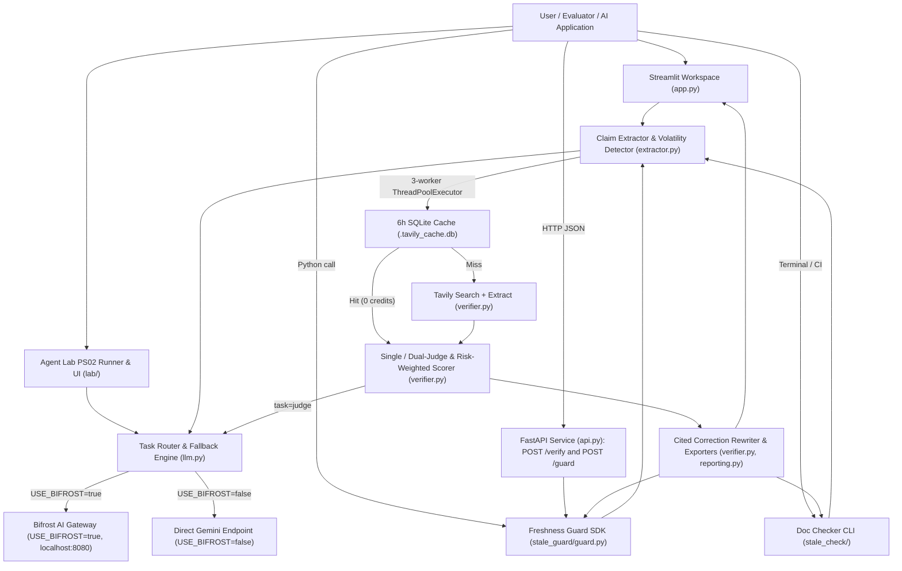

# Stale-Answer Detector & Agent Lab

**Verify time-sensitive AI claims against live web evidence, rewrite outdated facts with primary-source citations, guard RAG/chatbot replies over HTTP, and benchmark agent architectures reproducibly.**

---

## Demo Links

| Resource | Link |
| :--- | :--- |
| **Live App** | `TODO: Add deployed Streamlit Community Cloud / container URL` |
| **3-Minute Demo Video** | `TODO: Add YouTube / Loom demo video URL` |
| **GitHub Repository** | https://github.com/PurabTomar/stale-detector |
| **Pitch Deck Outline** | [`docs/PITCH_OUTLINE.md`](docs/PITCH_OUTLINE.md) |
| **3-Minute Video Script** | [`docs/DEMO_SCRIPT.md`](docs/DEMO_SCRIPT.md) |

---

## Note for Evaluators

- **Session Quotas & Rate Limits:** Live verification calls external Tavily and LLM APIs and is capped per session (`MAX_SESSION_AUDITS`, default `20`; `MAX_CLAIMS_PER_AUDIT`, default `8`; `MAX_TEXT_CHARS`, default `6000`). The Quota chip in the header displays **Live**, **Limited** (HTTP 429 / quota cap), **Offline** (unreachable host / 503), or **Saved results**.
- **Zero-Key Offline Evaluation:** Toggle **Demo mode** ON in the sidebar (or inspect the **Examples** section in **History**) to explore pre-verified audits, inline highlights, side-by-side diffs, and exports from [`demo_cache.json`](demo_cache.json) with `0` live API calls.
- **Real Saved Evidence Only:** Every Bifrost, Agent Lab, and multilingual metric shown in the UI is loaded directly from committed JSON files ([`evidence/bifrost_evidence.json`](evidence/bifrost_evidence.json) recorded **Nov 13, 2026**, [`lab/results/summary.json`](lab/results/summary.json) generated **Nov 14, 2026**, and [`evidence/multilingual_saved_audits.json`](evidence/multilingual_saved_audits.json)). Where live runs have not yet been generated (`benchmark/results.json`, `evidence/showdown_results.json`), the app and this README display honest empty/`TODO` states rather than fabricated numbers.

---

## Problem and Goal

### The Problem
1. **Silent Factual Staleness (PS06):** LLM answers sound fluent even when prices, software versions, tax slabs, interest rates, or office holders have changed since training. Users cannot tell *which* sentence is still accurate, *which* fact went stale, or *which* claim was never true.
2. **Inconsistent Agent Evaluation (PS02):** Comparing agent designs (plain LLM, single-search RAG, ReAct loop, multi-step verification pipelines, or external HTTP agents) is often ad-hoc—mixing models, omitting step-level traces, ignoring repeatability, and skipping failure modes (unavailable models, broken tools, misleading instructions).

### The Goal
Build one transparent, framework-independent system that:
- Audits AI answers, URLs, batches, and Markdown docs claim-by-claim against live web primary sources via **Tavily**,
- Routes LLM calls with task specialization, cross-provider failover, and full trace visibility via **Bifrost (Maxim AI)** (with a Direct Gemini fallback mode for cloud deployments),
- Generates **cited corrections** (`[1]`, `[2]`) while keeping unverified claims untouched and marked `[unverified]`,
- Exposes a drop-in **Freshness Guard** (`stale_guard/` + FastAPI `POST /guard`) for RAG/chatbot pipelines, and
- Evaluates 6 agent architectures reproducibly in **Agent Lab** with step traces and failure-injection scenarios.

---

## Features

- **Real-Event "Check Freshness" Workspace ([`app.py`](app.py), [`audit_animations.py`](audit_animations.py)):**
  - Five input modes inside an always-open **Input Studio**: **Paste an answer**, **Ask a question**, **Paste a URL**, **Batch** (`.txt`/`.md`/`.csv`, up to 20 items / 200 KB), and **Doc Checker** (line-numbered Markdown audit).
  - Live animations driven strictly by real pipeline events: scanning beam during claim detection, popping claim discovery chips with time-sensitivity bars (amber = flagged, grey = stable), live verification skeleton cards showing real `Search → Extract → Judge` substeps and `Sources read: N`, draw-on SVG score ring, staggered reveal, `prefers-reduced-motion` static progress bar, and a **Stop** button that cancels remaining workers cleanly and displays partial results.
- **Honest Failure Handling & Six-Status Scoring ([`verifier.py`](verifier.py)):**
  - Six statuses: **Fresh** (`75–100`), **Partially correct** (`45–74`), **Uncertain** (`40–74`), **Outdated** (`10–39`), **Incorrect** (`0–15`), **Unverifiable** (`N/A`), plus **Verification failed** (`—`, excluded from overall score and status counts with a per-claim **Retry this claim** button).
  - Category-aware verification including `leadership / office holder` (restricted to official government/company pages and widely reputable news), `capital / geography`, `records / latest`, `price`, `version`, `regulation`, `company`, and `statistic`.
  - Registered-domain deduplication (`+N pages`), single uppercase source label (`PRIMARY`, `NEWS`, `BLOG`, or `FORUM`), agreement counts matching displayed chips, and Hindi (Devanagari) / Hinglish input with English search queries.
- **Cited Corrections & Exports ([`verifier.py`](verifier.py), [`reporting.py`](reporting.py)):**
  - Every replaced fact (`outdated`, `incorrect`, `partially_correct`) receives numbered inline citations `[1]`, `[2]` linked to its primary source plus a **Sources** list.
  - Claims that could not be verified (`unverifiable`, `verification_failed`) stay untouched verbatim and marked `[unverified]`.
  - Included in the side-by-side diff UI, Markdown export, JSON export, and self-contained offline HTML export.
- **Freshness Guard SDK & HTTP API ([`stale_guard/`](stale_guard/guard.py), [`api.py`](api.py)):**
  - Python `guard(question, answer, context=None, max_claims=6)` and FastAPI `POST /guard` with input size limits, optional `GUARD_API_KEY` env auth, per-IP in-memory rate limiting, and OpenAPI `/docs`.
- **Doc Checker CLI ([`stale_check/`](stale_check/checker.py)):**
  - Terminal linter `python -m stale_check FILE.md [--max-claims 8] [--format md|json]` mapping stale findings to 1-based line numbers (`L42`), plus an optional manual GitHub Action.
- **Agent Lab (PS02) & Benchmark Dashboard ([`lab/`](lab/ui.py), [`benchmark.py`](benchmark.py)):**
  - Evaluates 6 architectures (`detector_pipeline`, `llm_only`, `react_loop`, `single_search`, `external_http`, `external_agent`) across repeatable tasks, failure scenarios, step traces, and Bifrost trace verification.
- **Security Hardening ([`settings.py`](settings.py), [`scripts/check_secrets.py`](scripts/check_secrets.py)):**
  - HTML escaping (`html.escape`) and `http(s)://`-only URL validation across all UI and report renderers; prompt-injection data delimiters (`<claim_to_verify>`, `<retrieved_web_evidence>`, `<original_answer_to_rewrite>`); SSRF private/local IP blocking on URL inputs; automated secrets scanner.

---

## Architecture



---

## Problem Statement 06 — Stale-Answer Detector (Requirement Mapping)

| PS06 Requirement | Status | Where It Is Met in Code |
| :--- | :--- | :--- |
| **Claim identification** (atomic factual claims + verbatim spans + multilingual Hindi/Hinglish) | Done | [`extractor.py`](extractor.py): `extract_claims()`, `_normalize_claims()`, `locate_span_in_text()`, `EXTRACTION_SYSTEM_PROMPT` |
| **Freshness / volatility detection** (separating volatile facts from stable facts before live search) | Done | [`extractor.py`](extractor.py): `assess_claim_volatility()`, category taxonomy (`leadership`, `geography`, `records`, `price`, `version`, `regulation`, `company`, `statistic`); [`verifier.py`](verifier.py): `partition_claims_by_threshold()` |
| **Live web verification** (primary-first search, domain packs, deep extract, office-holder source rules) | Done | [`verifier.py`](verifier.py): `search_tavily_for_claim()`, `extract_best_source()`, `filter_office_holder_sources()`, `load_verification_packs()` ([`verification_packs.json`](verification_packs.json)) |
| **Explainable freshness scoring per claim** (status bands, 4-signal breakdown, risk-weighted overall score, failure exclusion) | Done | [`verifier.py`](verifier.py): `compute_freshness_score()`, `compute_risk_weighted_overall_score()`, `STATUS_SCORE_BANDS` |
| **Meaningful Tavily integration** (category-smart search, `include_domains`, `tavily.extract()`, 6h SQLite cache, credit tracking) | Done | [`verifier.py`](verifier.py): `search_tavily_for_claim()`, `extract_article_from_url()`, `_cache_get()` / `_cache_set()`; [`ledger.py`](ledger.py): `compute_audit_ledger()` |
| **Meaningful Bifrost integration** (task routing, `x-bf-vk` virtual keys, `extra_body.fallbacks`, dual-judge, outage failover demo, trace evidence) | Done | [`llm.py`](llm.py): `call_llm_with_meta()`, `get_task_routing_summary()`, `check_gateway_health()`; [`bifrost_evidence.py`](bifrost_evidence.py); [`evidence/bifrost_evidence.json`](evidence/bifrost_evidence.json) |
| **Cited corrections & exports** (`[1]`, `[2]` primary-source links, untouched `[unverified]` claims, Markdown/HTML/JSON) | Done | [`verifier.py`](verifier.py): `build_citation_map()`, `apply_citations_to_corrected_answer()`, `generate_corrected_answer()`; [`reporting.py`](reporting.py): `format_report_markdown()`, `format_report_html()` |
| **Reusable application guard & doc linter** | Done | [`stale_guard/guard.py`](stale_guard/guard.py), [`api.py`](api.py) (`POST /guard`, `POST /verify`), [`stale_check/checker.py`](stale_check/checker.py) |

---

## Problem Statement 02 — Agent Lab (Requirement Mapping)

| PS02 Requirement | Status | Where It Is Met in Code |
| :--- | :--- | :--- |
| **Framework-independent agent adapters** (internal pipelines + black-box HTTP/subprocess external agents) | Done | [`lab/adapters.py`](lab/adapters.py): `AgentAdapter`, `ExternalHTTPAdapter`, `ExternalSubprocessAdapter`; [`lab/agents/`](lab/agents/) (`llm_only.py`, `single_search.py`, `react_loop.py`, `detector_pipeline.py`); [`examples/external_agent/`](examples/external_agent/) |
| **Consistent multi-metric evaluation** (accuracy, consistency, steps, tool calls, tokens, latency p95, optional USD cost) | Done (USD cost pricing table run: `TODO`) | [`lab/scoring.py`](lab/scoring.py): `score_run()`, `aggregate_leaderboard()`; [`lab/schema.py`](lab/schema.py). Note: saved `lab/results/summary.json` has `cost_display: "cost not set"` because no per-token USD price file was supplied during the Nov 14 run. |
| **Repeatability & resumable execution** (multi-repeat runs, deterministic task schema, resume-from-JSONL, dry-run estimator) | Done | [`lab/runner.py`](lab/runner.py): `BenchmarkRunner`, `estimate_benchmark_cost()`; [`lab/run.py`](lab/run.py) |
| **Failure-mode testing** (`unavailable_model` / `model_failure`, `broken_tool` / `tool_failure`, `misleading_instructions`) | Partial (`misleading_instructions` live run: `TODO`) | Implemented and unit-tested in [`lab/instrument.py`](lab/instrument.py), [`lab/runner.py`](lab/runner.py), and [`lab/tests/test_ps02_completion.py`](lab/tests/test_ps02_completion.py). Saved [`lab/results/summary.json`](lab/results/summary.json) (Nov 14, 2026) contains `clean`, `model_failure`, and `tool_failure` runs; `misleading_instructions` live runs are `TODO`. |
| **Inspection & comparison with step traces** (same-model matrix, same-agent matrix, step-by-step trace viewer, Bifrost trace coverage) | Done | [`lab/ui.py`](lab/ui.py): `render_agent_lab_tab()`; [`lab/results/runs.jsonl`](lab/results/runs.jsonl); [`lab/results/summary.json`](lab/results/summary.json) |

---

## How Tavily Contributes

[`verifier.py`](verifier.py) uses `tavily-python` to ground every factual check in live web evidence rather than model memory:

| Claim Category | Risk Level | Tavily Search Strategy | Search Depth |
| :--- | :--- | :--- | :--- |
| Mapped entity (`openai.com`, `apple.com`, `python.org`, `gstcouncil.gov.in`, `rbi.org.in`, etc.) | Critical / Moderate | Primary-first `include_domains` + open `topic="general"` | `advanced` (critical) / `basic` |
| `leadership / office holder` | Critical / Moderate | Official government/company domains + widely reputable news only | `advanced` |
| `price`, `regulation` | Critical | News + general or gov `include_domains` | `advanced` |
| `version`, `company`, `geography`, `records` | Moderate | Dual `topic="news"` (`time_range="month"`) + `topic="general"` | `basic` |
| `statistic`, `other` | Moderate / Low | Single `topic="general"` | `basic` |

- **Deep Extraction (`tavily.extract()`):** Fetches full page content from the highest-authority URL per claim to confirm exact prices, effective dates, and thresholds, and powers **Audit a URL** (12,000-char cap, 6h cached).
- **Thread-Safe 6-Hour SQLite Cache:** Persists search/extract responses in `.tavily_cache.db` (6-hour TTL) so repeated queries cost `0` Tavily credits.
- **Measured Evidence from Saved Files ([`lab/results/runs.jsonl`](lab/results/runs.jsonl) & [`lab/results/summary.json`](lab/results/summary.json), generated Nov 14, 2026):**
  - **435** tool/search steps recorded across **330** Agent Lab runs (`single_search`: `150` steps / `1.0` mean tool calls per run; `detector_pipeline`: `61` steps / `1.36` mean tool calls per run; `react_loop`: `44` steps / `0.98` mean tool calls per run; `external_http`: `90` steps; `external_agent`: `90` steps; `llm_only`: `0` steps).
  - Live 30-claim benchmark Tavily credit total (`benchmark/results.json`): `TODO` (not yet generated in this offline environment).

---

## How Bifrost Contributes

[`llm.py`](llm.py) routes all LLM tasks (claim extraction, single/dual freshness judging, cited correction rewrites, and Agent Lab runs) through **Bifrost AI Gateway (Maxim AI)** when `USE_BIFROST=true`, with a clean Direct Gemini mode (`USE_BIFROST=false`) when no gateway is running:

- **Task-Based Routing:** Separate models for `LLM_MODEL_EXTRACT` (fast/low-cost extraction) and `LLM_MODEL_JUDGE` (higher-accuracy judging).
- **Native Cross-Provider Failover:** Sends `extra_body={"fallbacks": [...]}` in canonical `provider/model` format plus 3-attempt exponential backoff on connection errors and app-level fallback traversal.
- **Virtual Keys & Trace Tagging:** Supports `LLM_VIRTUAL_KEY` (`x-bf-vk` header) and tags Agent Lab runs with `x-bf-run-id` for trace correlation.
- **Dual-Judge Consensus & Live Outage Demo:** Runs two distinct judge models over shared Tavily evidence and includes a **Simulate provider outage** sidebar toggle to demonstrate automatic failover live.
- **Measured Evidence from [`evidence/bifrost_evidence.json`](evidence/bifrost_evidence.json) (recorded Nov 13, 2026 on Bifrost v1.4.0 at `http://localhost:8080`):**

| Metric | Recorded Value | Source File |
| :--- | :--- | :--- |
| **Recorded Date** | `Nov 13, 2026` (`2026-11-13T17:55:59Z`) | `evidence/bifrost_evidence.json` |
| **Total Gateway Requests** | `490` across `330` runs | `evidence/bifrost_evidence.json` |
| **Automatic Failovers (`failover_success`)** | `10` (`gemini-3.1-flash-lite` → `gemini-3.5-flash`) | `evidence/bifrost_evidence.json` |
| **Total Tokens Routed** | `127,854` (`100,710` prompt / `27,144` completion) | `evidence/bifrost_evidence.json` |
| **Mean Gateway Latency** | `8,011.43 ms` | `evidence/bifrost_evidence.json` |
| **Model Breakdown** | `gemini-3.1-flash-lite`: `401` reqs (`121,221` tok, `7,307.08 ms` avg); `gemini-3.5-flash`: `20` reqs / `10` fallbacks (`6,633` tok, `7,725.51 ms` avg); generic `llm` entries: `69` reqs | `evidence/bifrost_evidence.json` |
| **Trace Tag Coverage (`x-bf-run-id`)** | `330 / 330` runs (`100%`) | `lab/results/summary.json` |

---

## Add a freshness guard to your RAG or chatbot

Use the `stale_guard` package (or the FastAPI `POST /guard` endpoint) to verify any chatbot or RAG reply against live web sources before returning it to users. When stale or incorrect claims are found, `stale_guard` returns a cited `corrected_answer` with numbered `[1]`, `[2]` primary-source links and keeps any unverified claims untouched and marked `[unverified]`.

### Python SDK (~15-line chatbot wrapper)

See [`examples/chatbot_guard_example.py`](examples/chatbot_guard_example.py):

```python
from stale_guard import guard

def safe_chatbot_reply(question: str, raw_bot_reply: str, rag_context: str | None = None) -> str:
    result = guard(question=question, answer=raw_bot_reply, context=rag_context, max_claims=6)
    if result["verdict"] in {"stale", "incorrect"}:
        return result["corrected_answer"]
    if result["verdict"] in {"needs_review", "verification_failed"}:
        return f"{result['corrected_answer']}\n\n(Note: some facts could not be verified live.)"
    return raw_bot_reply
```

`guard(question, answer, context=None, max_claims=6)` returns a dictionary with:
- `verdict`: `"fresh"`, `"stale"`, `"incorrect"`, `"needs_review"`, `"verification_failed"`, or `"no_claims"`
- `overall_score`: risk-weighted `0–100` integer (or `None` when claims could not be verified)
- `claims`: per-claim verification objects
- `corrected_answer`: rewritten answer with `[1]`, `[2]` citations + `Sources:` list (and `[unverified]` markers for claims left untouched)
- `sources`: deduplicated primary and supporting sources
- `usage`: real measured `latency_ms`, returned token counts (`prompt_tokens`, `completion_tokens`, `total_tokens`), `llm_calls`, `tavily_credits_used`, `routing_mode`, and `models_used`

### HTTP Endpoint (`POST /guard`)

Start the FastAPI service (`uvicorn api:app --host 0.0.0.0 --port 8000`) and open interactive OpenAPI docs at `http://localhost:8000/docs`:

```bash
curl -X POST http://localhost:8000/guard \
  -H "Content-Type: application/json" \
  -H "X-API-Key: $GUARD_API_KEY" \
  -d '{
    "question": "What is the latest stable Python release?",
    "answer": "Python 3.11 is currently the latest stable release.",
    "max_claims": 6
  }'
```

**Built-in guardrails on `POST /guard`:**
- **Size limits**: `question <= 1,000` chars, `answer <= 6,000` chars, optional `context <= 8,000` chars, `1 <= max_claims <= 8`.
- **Optional API key**: set `GUARD_API_KEY` (or `STALE_GUARD_API_KEY`) in `.env` to require `X-API-Key` or `Authorization: Bearer <key>` (returns HTTP `401` if invalid/missing; open if unset).
- **In-memory per-IP rate limit**: defaults to `30` requests per `60` seconds per IP (`GUARD_RATE_LIMIT_REQUESTS` and `GUARD_RATE_LIMIT_WINDOW_SECONDS`), returning HTTP `429` with `Retry-After` when exceeded.

---

## Doc Checker CLI & Optional Manual GitHub Action

Audit any Markdown or documentation file from the terminal using [`stale_check/`](stale_check/checker.py):

```bash
python -m stale_check README.md
python -m stale_check docs/api.md --max-claims 8 --format json
```

- Maps every finding to its 1-based line number (`L42`), respects quota/env settings, and exits with code `1` if outdated or contradicted claims are found.
- An optional manual (`workflow_dispatch`) workflow is provided in [`.github/workflows/stale-check.yml`](.github/workflows/stale-check.yml).

---

## Installation (Windows, macOS & Linux)

Requires **Python 3.12+**.

### Windows (PowerShell)
```powershell
git clone https://github.com/PurabTomar/stale-detector.git
cd stale-detector
python -m venv .venv
.\.venv\Scripts\Activate.ps1
pip install -r requirements.txt
Copy-Item .env.example .env
```

### macOS
```bash
git clone https://github.com/PurabTomar/stale-detector.git
cd stale-detector
python3.12 -m venv .venv
source .venv/bin/activate
pip install -r requirements.txt
cp .env.example .env
```

### Linux
```bash
git clone https://github.com/PurabTomar/stale-detector.git
cd stale-detector
python3.12 -m venv .venv
source .venv/bin/activate
pip install -r requirements.txt
cp .env.example .env
```

---

## Environment Variables

Configure variables in `.env` (local) or Streamlit Secrets (cloud). **Never commit real keys.**

| Variable Name | Required | Purpose |
| :--- | :--- | :--- |
| `USE_BIFROST` | Optional | Set `true` to route through Bifrost AI Gateway or `false` for Direct Gemini API |
| `LLM_BASE_URL` | When `USE_BIFROST=true` | OpenAI-compatible Bifrost gateway base URL |
| `LLM_API_KEY` | Yes (live mode) | API key for Bifrost gateway or Direct Gemini |
| `GEMINI_API_KEY` | Optional | Alternative Google Gemini API key variable when `USE_BIFROST=false` |
| `LLM_VIRTUAL_KEY` | Optional | Bifrost virtual key sent via the `x-bf-vk` header |
| `LLM_MODEL` | Optional | Default LLM model ID |
| `LLM_MODEL_EXTRACT` | Optional | Dedicated model ID for claim extraction |
| `LLM_MODEL_JUDGE` | Optional | Dedicated model ID for freshness judging |
| `LLM_MODEL_JUDGE_2` | Optional | Second judge model ID for Dual-judge consensus mode |
| `LLM_MODEL_FALLBACKS` | Optional | Comma-separated fallback model chain (supports `provider/model` in Bifrost mode) |
| `TAVILY_API_KEY` | Yes (live mode) | Tavily Search & Extract API key |
| `TAVILY_CACHE_PATH` | Optional | Custom filesystem path for the 6-hour SQLite cache |
| `ENTITY_DOMAIN_MAP` | Optional | JSON object extending/overriding primary-first entity domains |
| `MAX_TEXT_CHARS` | Optional | Input text character limit per audit (default `6000`) |
| `MAX_CLAIMS_PER_AUDIT` | Optional | Hard cap on claims verified per audit (default `8`) |
| `MAX_SESSION_AUDITS` | Optional | Per-session live audit quota limit (default `20`) |
| `GUARD_API_KEY` | Optional | Optional API key protecting `POST /guard` (`X-API-Key` or `Bearer`) |
| `STALE_GUARD_API_KEY` | Optional | Alias for `GUARD_API_KEY` |
| `GUARD_RATE_LIMIT_REQUESTS` | Optional | Max `POST /guard` requests per IP per window (default `30`) |
| `GUARD_RATE_LIMIT_WINDOW_SECONDS` | Optional | Sliding window duration in seconds for `POST /guard` (default `60`) |

---

## Running With and Without Bifrost

### Option A — Offline Demo Mode (No API Keys)
```bash
streamlit run app.py
```
Toggle **Demo mode** ON in the sidebar to replay cached audits from `demo_cache.json`.

### Option B — With Bifrost AI Gateway (`USE_BIFROST=true`)
1. Start Bifrost locally (e.g., `docker compose --profile bifrost up --build` or your local Bifrost binary on port `8080`) and configure provider keys inside the Bifrost dashboard (`http://localhost:8080`).
2. Set `USE_BIFROST=true`, `LLM_BASE_URL`, `LLM_API_KEY`, `LLM_MODEL*`, and `TAVILY_API_KEY` in `.env` (optionally `LLM_VIRTUAL_KEY` and `LLM_MODEL_FALLBACKS`).
3. Run the UI or API:
```bash
streamlit run app.py
# Or FastAPI service (POST /verify and POST /guard):
uvicorn api:app --host 0.0.0.0 --port 8000
```

### Option C — Without Bifrost / Direct Gemini Mode (`USE_BIFROST=false`)
1. Set `USE_BIFROST=false`, `GEMINI_API_KEY` (or `LLM_API_KEY`), and `TAVILY_API_KEY` in `.env` or `.streamlit/secrets.toml`.
2. Launch `streamlit run app.py` (or `uvicorn api:app --host 0.0.0.0 --port 8000`). The app automatically targets Google Gemini's OpenAI-compatible endpoint and updates UI routing chips and counters to **Direct Gemini API** / **LLM calls (direct Gemini)**.

---

## Running the Benchmarks

### 1. PS06 30-Claim Freshness Benchmark
```bash
python benchmark.py --update-readme
```
Optional flags: `--no-cache`, `--dual-judge`, `--workers 3`. Results are saved to `benchmark/results.json` and update the table below.

### 2. PS02 Agent Lab Benchmark
```bash
# Dry-run cost/call estimate (0 API calls)
python -m lab.run --dry-run

# Execute benchmark across agents, repeats, and failure scenarios
python -m lab.run --agents llm_only,single_search,react_loop,detector_pipeline --repeats 3
```
Saved Agent Lab results live in [`lab/results/summary.json`](lab/results/summary.json) (**330** runs across **6** architectures, **15** tasks, generated **Nov 14, 2026**).

### 3. Real Model Showdown Generator
```bash
python scripts/generate_showdown.py
```
Runs 3 questions against 2–3 real configured models through active routing and persists [`evidence/showdown_results.json`](evidence/showdown_results.json) (currently `TODO` — not yet recorded).

<!-- BENCHMARK_RESULTS_START -->
> **Status:** `TODO` — Live 30-claim benchmark (`benchmark/results.json`) has not been generated yet in this offline setup. Start Bifrost on port 8080 (or set `USE_BIFROST=false` + `GEMINI_API_KEY`) with `TAVILY_API_KEY` and run `python benchmark.py --update-readme` to populate live metrics below automatically.

### PS06 Benchmark Dataset (`benchmark/dataset.json` — 30 Labelled Claims)
Distribution: **13 `outdated`**, **12 `fresh`**, **3 `incorrect`**, **1 `uncertain`**, **1 `unverifiable`** across `price` (4), `version` (7), `regulation` (5), `company` (8), `statistic` (5), `other` (1). Live accuracy/precision/recall/F1: `TODO`.

### PS02 Agent Lab Recorded Leaderboard (`lab/results/summary.json`, Nov 14, 2026 — 330 Runs)

| Agent | Runs (`n`) | Accuracy | Consistency | Mean Steps | Mean Tool Calls | Mean Tokens | Mean Latency | Clean / `tool_failure` / `model_failure` |
| :--- | :---: | :---: | :---: | :---: | :---: | :---: | :---: | :--- |
| `detector_pipeline` | 45 | `64.4%` | `60.0%` | `3.78` | `1.36` | `623.9` | `33.27s` | `64.4%` / `TODO` / `TODO` |
| `llm_only` | 75 | `56.0%` | `0.0%` | `1.03` | `0.0` | `190.1` | `8.68s` | `93.3%` / `0.0%` / `0.0%` |
| `react_loop` | 45 | `48.9%` | `40.0%` | `3.0` | `0.98` | `787.8` | `48.54s` | `48.9%` / `TODO` / `TODO` |
| `single_search` | 75 | `48.0%` | `0.0%` | `2.04` | `1.0` | `307.6` | `12.21s` | `80.0%` / `0.0%` / `0.0%` |
| `external_http` (black-box) | 45 | `0.0%` | `0.0%` | `4.0` | `2.0` | `300.0` | `18.51s` | `0.0%` (offline adapter placeholder; live external server `TODO`) |
| `external_agent` (black-box) | 45 | `0.0%` | `0.0%` | `4.0` | `2.0` | `300.0` | `22.94s` | `0.0%` (offline adapter placeholder; live external server `TODO`) |
<!-- BENCHMARK_RESULTS_END -->

---

## Running Tests

All unit tests run completely offline with mocked network calls and require zero API keys:

```bash
# Scan repository and results folders for leaked secret patterns
python scripts/check_secrets.py

# Root offline unit test suite (298 tests)
python -m unittest discover -s . -p "test_*.py" -v

# Agent Lab PS02 offline unit test suite (52 tests)
python -m unittest discover -s lab/tests -p "test_*.py" -v
```

Latest verified local offline test run: **350 / 350 tests passing** (`298` root + `52` Agent Lab) and **0 secrets detected**.

---

## Deployment Readiness

The repository includes container, orchestration, task-runner, and offline CI files:

- [`Dockerfile`](Dockerfile) — `python:3.12-slim` image running as non-root `appuser` (`UID 10001`) with a built-in `HEALTHCHECK` against `/_stcore/health` and `STREAMLIT_BROWSER_GATHER_USAGE_STATS=false`.
- [`docker-compose.yml`](docker-compose.yml) — runs the Streamlit `app` service on port `8501`, plus optional `api` (`--profile api`, port `8000`) and Maxim AI `bifrost` (`--profile bifrost`, port `8080`) profiles.
- [`.dockerignore`](.dockerignore) — excludes `.git`, `.env*`, `.tavily_cache.db`, caches, and local artifacts so secrets are never copied into Docker build contexts.
- [`Makefile`](Makefile) — shortcuts for `make run`, `make run-api`, `make test`, `make check-secrets`, `make docker-build`, `make docker-up`, and `make docker-up-bifrost`.
- [`.github/workflows/ci.yml`](.github/workflows/ci.yml) — runs `scripts/check_secrets.py`, module import verification, and the full offline mocked unit test suite on Python 3.12 with **no repository secrets required**.

```bash
# App only
docker compose up --build

# App + optional local Bifrost AI Gateway
docker compose --profile bifrost up --build

# App + FastAPI Guard API
docker compose --profile api up --build
```

### What was tested locally vs. not tested locally

- **Tested locally:** Full offline mocked unit test suite (`298` root + `52` Agent Lab = `350` tests), `stale_guard.guard()` and FastAPI `POST /guard` (size limits, `GUARD_API_KEY`, per-IP rate limiting, OpenAPI schema) via FastAPI `TestClient`, cited corrections in Markdown/HTML exports, headless Streamlit startup (`/_stcore/health` HTTP `200 ok`), and `scripts/check_secrets.py`.
- **Not tested locally:** Building or running `Dockerfile` and `docker-compose.yml` (including the optional `bifrost` and `api` Compose profiles), running `Makefile` via GNU `make`, and executing `.github/workflows/ci.yml` on GitHub-hosted runners — `docker` and `make` were not installed in the local Windows development environment.

---

## Project Structure

- [`app.py`](app.py) — Five-tab Streamlit UI (`AUDIT`, `COMPARE`, `AGENT LAB`, `LEARN`, `HISTORY`), real-event live stepper & animations, Stop button, cited diff view, and offline Demo mode
- [`audit_animations.py`](audit_animations.py) — Pure event-to-UI-state reducer and HTML renderers for the Check Freshness live animation pipeline
- [`assets/style.css`](assets/style.css) — Dark/light glassmorphism theme, responsive layout, GPU-composited animations, and `prefers-reduced-motion` static progress bar fallback
- [`extractor.py`](extractor.py) — Claim & verbatim span extractor, volatility scorer, category normalizer, and Hindi/Hinglish English-query generator
- [`verifier.py`](verifier.py) — Tavily primary-first Search & Extract, 6h SQLite cache, office-holder source filtering, single/dual-judge scorer, failure handling, live event callbacks, Stop cancellation, and cited correction rewriter
- [`llm.py`](llm.py) — Gateway-aware OpenAI SDK client supporting Bifrost (`USE_BIFROST=true`) and Direct Gemini (`USE_BIFROST=false`) with exponential backoff and fallbacks
- [`reporting.py`](reporting.py) — Word-level diff builder, cited HTML/Markdown/JSON report exporters, and XSS-safe URL/text helpers
- [`stale_guard/`](stale_guard/guard.py) — Python Freshness Guard package (`guard(...)`) for RAG & chatbot applications
- [`api.py`](api.py) — FastAPI REST service exposing `POST /guard`, `POST /verify`, `GET /health`, and OpenAPI `/docs`
- [`stale_check/`](stale_check/checker.py) — Markdown/documentation freshness linter CLI (`python -m stale_check`)
- [`lab/`](lab/) — PS02 Agent Lab harness (adapters, 4 internal agents, external HTTP/subprocess adapters, failure injection, runner, scorer, UI, and 52 unit tests)
- [`evidence/`](evidence/) — Real saved Bifrost gateway telemetry (`bifrost_evidence.json`, Nov 13, 2026) and saved multilingual audits (`multilingual_saved_audits.json`)
- [`benchmark.py`](benchmark.py) & [`benchmark/dataset.json`](benchmark/dataset.json) — 30-claim labelled freshness benchmark
- [`examples/chatbot_guard_example.py`](examples/chatbot_guard_example.py) — ~15-line chatbot wrapper example using `stale_guard`
- [`docs/PITCH_OUTLINE.md`](docs/PITCH_OUTLINE.md) & [`docs/DEMO_SCRIPT.md`](docs/DEMO_SCRIPT.md) — Submission pitch outline and 3-minute demo video script
- [`scripts/check_secrets.py`](scripts/check_secrets.py) & [`scripts/generate_showdown.py`](scripts/generate_showdown.py) — Secrets scanner and real Model Showdown recorder
- [`Dockerfile`](Dockerfile), [`docker-compose.yml`](docker-compose.yml), [`.dockerignore`](.dockerignore), [`Makefile`](Makefile), [`.github/workflows/ci.yml`](.github/workflows/ci.yml) — Container and CI readiness

---

## Technologies Used

- **Backend & Orchestration:** Python 3.12, OpenAI Python SDK, FastAPI, Pydantic, Uvicorn, SQLite3 (`threading` + `ThreadPoolExecutor`)
- **Live Web Grounding:** Tavily Search & Extract (`tavily-python`)
- **LLM Gateway & Models:** Maxim AI Bifrost Gateway (`maximhq/bifrost`), Google Gemini (`gemini-3.1-flash-lite`, `gemini-3.5-flash`, plus configurable cross-provider fallbacks via Bifrost)
- **Frontend:** Streamlit, custom CSS3 glassmorphism & GPU-composited animations (`assets/style.css`), Pandas
- **Testing & Packaging:** Python `unittest` + `unittest.mock`, FastAPI `TestClient`, Streamlit `AppTest`, Docker / Docker Compose, GitHub Actions

---

## AI Usage Disclosure

### 1. AI Development Tools Used
This repository was built with the assistance of AI coding and reasoning tools, including **Google Antigravity**, **Gemini**, and **Claude**, used for architecture iteration, code generation, UI CSS refinement, security hardening, test authoring, and documentation drafting. All generated code was verified with automated offline tests (`350` unit tests), secret scanning (`scripts/check_secrets.py`), and headless startup checks.

### 2. How AI Is Used Inside the Product
- **Claim Extraction (`extractor.py`):** An LLM parses untrusted user/web text inside delimited data tags into structured JSON factual claims, verbatim spans, categories, and English search queries (including from Hindi/Hinglish text).
- **Freshness Judging (`verifier.py`):** One or two judge LLMs (single or dual-judge mode) compare each extracted claim strictly against retrieved Tavily snippets and extracted primary pages, returning schema-validated JSON verdicts (`fresh`, `outdated`, `incorrect`, `partially_correct`, `uncertain`, `unverifiable`).
- **Cited Correction Rewriting (`verifier.py`):** An optional LLM rewrite step updates outdated/incorrect sentences with verified current facts while attaching `[1]`, `[2]` primary-source citations and leaving unverified claims untouched and marked `[unverified]`.
- **Agent Lab Comparisons (`lab/`):** Evaluates LLM-based agent architectures side-by-side under controlled clean and failure-injected scenarios.

---

## Limitations

- **Search Index & Reachability:** Live verification relies on pages indexed by Tavily Search. Paywalled articles, bot-blocked portals, or breaking updates from the last few minutes may yield `uncertain` or `unverifiable`.
- **Unrecorded Live Datasets Marked `TODO`:** `benchmark/results.json` (30-claim live run), `evidence/showdown_results.json`, `lab` `misleading_instructions` live runs, live external HTTP agent runs, and USD pricing-table cost runs have not yet been generated in this offline setup and are honestly marked `TODO`.
- **6-Hour Cache Trade-Off:** Cached Tavily responses conserve credits; intra-hour breaking news will reuse cached entries until the 6-hour TTL expires or cache is cleared in Settings.
- **Direct Gemini vs. Bifrost Mode:** Multi-provider failover across OpenAI/Anthropic/Groq, `x-bf-vk` virtual keys, and local Bifrost dashboard logs require `USE_BIFROST=true` with a running Bifrost gateway.
- **Not Legal, Tax, or Medical Advice:** Scores and cited rewrites are automated verification aids; always inspect the linked primary sources before making legal, financial, or medical decisions.

---

## Future Work

- Run and commit live results for `benchmark/results.json` (30 claims), `evidence/showdown_results.json`, and Agent Lab `misleading_instructions` + live external HTTP agent scenarios.
- Validate `Dockerfile` and `docker-compose.yml` (`app` + `bifrost` + `api` profiles) on a Docker-enabled host.
- Add persistent Redis-backed distributed rate limiting for multi-replica `POST /guard` deployments.
- Add browser-extension / Slack-bot wrappers powered by `POST /guard` and webhook alerts for watched claims that flip from `fresh` to `outdated`.
- Add a configurable per-model USD pricing table to `lab/scoring.py` for automated cost-per-correct-answer Pareto curves.

---

## License

Released under the **MIT License**. See [`LICENSE`](LICENSE) for full terms.
