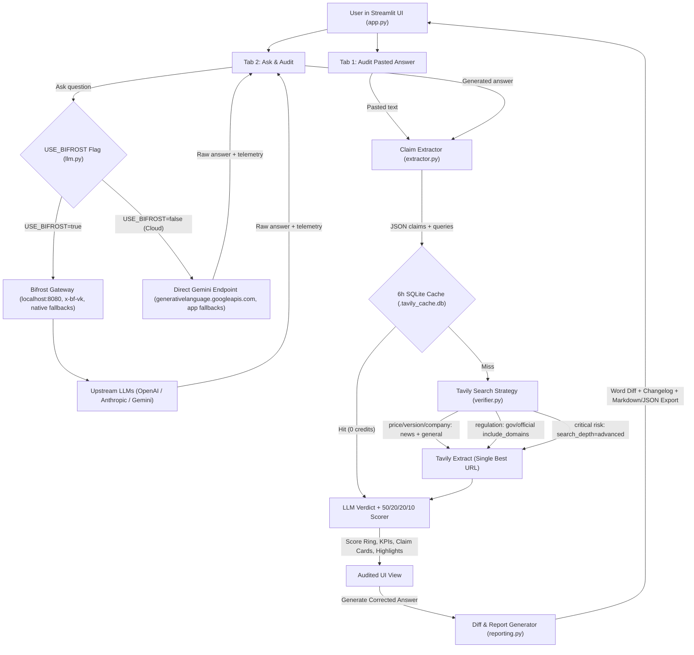

# Stale-Answer Detector

Verify time-sensitive AI claims against live web sources, inspect explainable freshness scores (`0–100`), highlight stale details inline, and rewrite outdated answers with today's verified facts.

---

## The Problem

LLM responses are frozen at their training cutoff (or searchless generation step) and silently go stale when the real world moves on:

- **Product & API pricing** changes (e.g., flagship smartphone prices, model token rates)
- **Software & SDK versions** ship new releases or deprecations
- **Laws, tax slabs, & compliance rules** get amended
- **Company leadership, acquisitions, & valuations** shift frequently
- **Statistics & benchmarks** become obsolete quickly

Users rarely know *which* sentence in a polished AI response is still accurate and which detail is quietly outdated. **Stale-Answer Detector** audits AI text claim-by-claim against live web evidence so stale facts are flagged, explained, and cleanly corrected.

---

## Architecture



---

## How Tavily Is Used

`verifier.py` uses `tavily-python` with strategy selection, targeted extraction, and credit conservation rather than one-size-fits-all web search:

| Claim Category | Risk Level | Tavily Search Strategy | Search Depth |
| :--- | :--- | :--- | :--- |
| `price` | Critical | Dual search: `topic="news"` (`time_range="month"`) + `topic="general"` | `advanced` |
| `regulation` | Critical | Official/gov `include_domains` (`*.gov`, `*.gov.in`, `sec.gov`, `europa.eu`, etc.) with `include_domains_mode="prefer"` | `advanced` |
| `version`, `company` | Moderate | Dual search: `topic="news"` (`time_range="month"`) + `topic="general"` | `basic` |
| `statistic`, `other` | Moderate / Low | Single `topic="general"` search | `basic` |

1. **Single-URL `tavily.extract()`**: After ranking retrieved domains by authority, Tavily Extract reads the single highest-authority result URL to confirm exact numbers, effective dates, and thresholds.
2. **6-Hour On-Disk SQLite Cache (`.tavily_cache.db`)**: Repeat audits within 6 hours reuse cached search/extract payloads for `0` additional Tavily credits.
3. **Explainable `0–100` Freshness Score**:
   - **50%** LLM Verdict (`fresh`, `outdated`, or `uncertain`)
   - **20%** Source Recency (from Tavily `published_date`, neutral `50` when undated)
   - **20%** Source Agreement across retrieved results
   - **10%** Source Authority (`.gov`, `.edu`, official docs, and company sites outrank forums/blogs)
4. **Live Credit & Error Handling**: Tracks credits spent in the sidebar (`Tavily credits used this session`), retries transient `429`/timeouts once, and surfaces friendly messages for `401` invalid keys and `429`/`432`/`433`/`434` rate or credit limits.

---

## How Bifrost Is Used (and Cloud Mode)

`llm.py` supports two clean routing modes controlled by `USE_BIFROST` without any code changes:

### 1. Bifrost AI Gateway Mode (`USE_BIFROST=true`, default)
- **Native Single-Call Fallbacks**: Sends `extra_body={"fallbacks": [...]}` with every request so Bifrost fails over cleanly across configured providers/models (e.g., `openai/gpt-4o-mini` → `anthropic/claude-3-5-sonnet` → `gemini/gemini-2.5-flash`).
- **Virtual Key Support**: Reads optional `LLM_VIRTUAL_KEY` and passes `default_headers={"x-bf-vk": ...}`.
- **Unreachable-Only Safety Retry**: Keeps a single 1-second app-level retry only if the gateway is unreachable (`APIConnectionError`, `APITimeoutError`, `502/503/504`).
- **Live Sidebar Gateway Panel**:
  - Probes `GET /health` for a green **Gateway healthy** or red **Gateway offline** badge
  - Links directly to **Bifrost dashboard logs** (default `http://localhost:8080`)
  - Tracks per-request model, latency (`ms`), prompt/completion tokens, session totals, and `Fallback used: A -> B` badges
  - Includes a **Simulate provider outage** toggle to demonstrate live automatic failover

### 2. Direct Gemini Cloud Mode (`USE_BIFROST=false`)
- Designed for **Streamlit Community Cloud** or environments where no local Bifrost gateway is running.
- Routes directly to Google's OpenAI-compatible Gemini endpoint (`https://generativelanguage.googleapis.com/v1beta/openai/`).
- Automatically omits Bifrost-specific headers (`x-bf-vk`) and root fields (`extra_body.fallbacks`), normalizes `gemini/` model prefixes (defaulting to `gemini-2.5-flash`), and performs app-level fallback across `LLM_MODEL_FALLBACKS` on `429`, `500`, `503`, or `404` responses.

---

## Setup Steps

### 1. Clone and Install Dependencies

```bash
git clone <your-repo-url>
cd stale-detector
pip install -r requirements.txt
```

### 2. Option A — Run Locally with Bifrost (`USE_BIFROST=true`)

1. Start your Bifrost gateway (default `http://localhost:8080`) with your provider keys configured.
2. Copy `.env.example` to `.env`:

   ```bash
   cp .env.example .env
   ```

3. Edit `.env`:

   ```env
   USE_BIFROST=true
   LLM_BASE_URL=http://localhost:8080/v1
   LLM_API_KEY=bifrost-local
   LLM_MODEL=openai/gpt-4o-mini
   LLM_MODEL_FALLBACKS=anthropic/claude-3-5-sonnet-20241022,gemini/gemini-2.5-flash
   # Optional Bifrost virtual key:
   # LLM_VIRTUAL_KEY=bf_vk_your_virtual_key

   TAVILY_API_KEY=tvly-your-tavily-api-key
   ```

4. Launch the app:

   ```bash
   streamlit run app.py
   ```

### 3. Option B — Run Direct Gemini / Deploy to Streamlit Community Cloud (`USE_BIFROST=false`)

No local gateway needed — just set `USE_BIFROST=false` with a Google Gemini API key and a Tavily API key.

**Local `.env`:**

```env
USE_BIFROST=false
LLM_API_KEY=your-google-gemini-api-key
LLM_MODEL=gemini-2.5-flash
LLM_MODEL_FALLBACKS=gemini-2.5-flash-lite,gemini-2.0-flash
TAVILY_API_KEY=tvly-your-tavily-api-key
```

*(You may also use `GEMINI_API_KEY` instead of `LLM_API_KEY` when `USE_BIFROST=false`.)*

**Streamlit Community Cloud (`Settings → Secrets`):**

```toml
USE_BIFROST = "false"
LLM_API_KEY = "your-google-gemini-api-key"
LLM_MODEL = "gemini-2.5-flash"
LLM_MODEL_FALLBACKS = "gemini-2.5-flash-lite"
TAVILY_API_KEY = "tvly-your-tavily-api-key"
```

### 4. Run the REST API (`api.py`)

Other AI applications and agent pipelines can verify answers programmatically over HTTP using the FastAPI service:

```bash
uvicorn api:app --host 0.0.0.0 --port 8000
```

Interactive OpenAPI docs are available at `http://localhost:8000/docs`.

**`curl` example (`POST /verify`):**

```bash
curl -X POST http://localhost:8000/verify \
  -H "Content-Type: application/json" \
  -d '{
    "answer": "Apple sells the iPhone 15 Pro Max as its latest flagship for $1,199, and OpenAI GPT-4 Turbo costs $10 per million input tokens."
  }'
```

Sample response (abbreviated):

```json
{
  "app": "Stale-Answer Detector",
  "routing_mode": "bifrost",
  "generated_at": "2026-11-11T14:32:22+05:30",
  "original_answer": "...",
  "summary": {
    "overall_score": 22,
    "overall_tier": "Stale",
    "claims_checked": 2,
    "fresh": 0,
    "uncertain": 0,
    "outdated": 2,
    "tavily_credits_used": 6.4
  },
  "models_used": ["openai/gpt-4o-mini"],
  "claims": [
    {
      "index": 1,
      "claim": "Apple sells the iPhone 15 Pro Max as its latest flagship for $1,199.",
      "category": "price",
      "status": "outdated",
      "score": 20,
      "confidence": "high",
      "risk_level": "critical",
      "current_info": "...",
      "reason": "...",
      "sources": [
        { "title": "Apple", "url": "https://www.apple.com/iphone/" }
      ]
    }
  ]
}
```

### 5. Run Automated Tests

```bash
python -m unittest test_llm.py test_extractor.py test_verifier.py test_reporting.py test_api.py -v
```

---

## Demo Screenshots

Add screenshots of your running session under `docs/screenshots/` to populate these placeholders:

1. **Audit Pasted Answer Workspace** — Circular freshness ring (`Fresh` / `Mixed` / `Stale`), 4 KPI cards, and per-claim **"Why this score?"** breakdowns.
   > *Screenshot placeholder:* save to `docs/screenshots/audit-pasted-answer.png` → ``
2. **Ask & Audit with Inline Claim Highlights** — Generated LLM answer annotated with red underlines for outdated claims and green underlines for verified fresh claims.
   > *Screenshot placeholder:* save to `docs/screenshots/ask-and-audit-highlights.png` → ``
3. **Side-by-Side Diff & Changelog Export** — Word-level red/green rewrite comparison, source-backed **"What changed & why"** cards, and Markdown/JSON report downloads.
   > *Screenshot placeholder:* save to `docs/screenshots/corrected-word-diff.png` → ``
4. **Bifrost Gateway Panel & Outage Failover** — Live health status, session token telemetry, and `Fallback used: A -> B` badge during simulated primary outage.
   > *Screenshot placeholder:* save to `docs/screenshots/bifrost-gateway-panel.png` → ``

---

## Project Structure

- [`app.py`](app.py) — Two-tab dark-themed Streamlit UI, live status tracker, inline highlights, error translator, and sidebar panels
- [`api.py`](api.py) — FastAPI REST service exposing `POST /verify` and `GET /health` for external AI applications
- [`extractor.py`](extractor.py) — Claim extractor and JSON schema normalizer
- [`verifier.py`](verifier.py) — Category-smart Tavily search, single-URL extraction, 6h SQLite cache, 50/20/20/10 scorer, and answer rewriter
- [`llm.py`](llm.py) — OpenAI SDK client supporting Bifrost native fallbacks (`USE_BIFROST=true`), Direct Gemini endpoint (`USE_BIFROST=false`), health checks, and telemetry
- [`reporting.py`](reporting.py) — Word-level HTML diff builder, source-backed changelog, and Markdown/JSON report exporters
- [`.streamlit/config.toml`](.streamlit/config.toml) — Dark theme configuration
- [`.env.example`](.env.example) — Configuration template for Bifrost and Direct Gemini Cloud modes
- [`test_llm.py`](test_llm.py), [`test_extractor.py`](test_extractor.py), [`test_verifier.py`](test_verifier.py), [`test_reporting.py`](test_reporting.py), [`test_api.py`](test_api.py) — Unit tests for routing, fallback chains, JSON extraction, scoring math, report exports, and the REST API

---

## Limitations

- **Search Index & Extract Reachability**: Live verification relies on pages indexed by Tavily Search. Paywalled articles, bot-blocked domains, JavaScript-only portals, or breaking updates from the last few minutes may return incomplete snippets or fail `tavily.extract()`, lowering confidence to `low` or `uncertain`.
- **Undated Web Pages**: Source recency (`20%` of the score) depends on Tavily `published_date` metadata. Many official documentation or pricing pages omit publish timestamps and therefore receive a neutral `50/100` recency score.
- **LLM Extractor & Judge Judgment Calls**: Highly implicit claims, heavy pronoun chains, or sarcastic/hypothetical text can be skipped during extraction, and conflicting web snippets can cause the judge model to mark a claim `uncertain`.
- **6-Hour Cache Trade-Off**: Cached Tavily responses conserve API credits, which means intra-hour changes (such as flash sales or live stock tickers) will not re-query Tavily until the 6-hour TTL expires or you click **Clear Tavily cache** in the sidebar **Settings** expander.
- **Direct Gemini Mode (`USE_BIFROST=false`)**: Bypassing Bifrost enables effortless cloud deployment on Streamlit Community Cloud, but single-request multi-provider gateway routing (OpenAI/Anthropic fallbacks via one gateway), `x-bf-vk` virtual keys, **Simulate provider outage**, and local Bifrost dashboard logs are unavailable when `USE_BIFROST=false`.
- **Not Legal or Financial Advice**: Scores and rewrites are best-effort automated checks; always inspect the clickable source chips before acting on legal, tax, medical, or pricing decisions.
